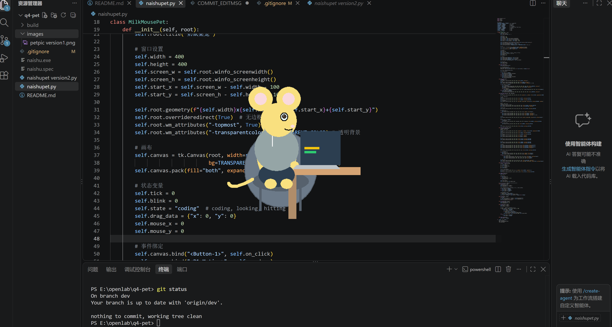

# 桌面宠物 NaishuPet 2（奶鼠桌宠）

一个用 Python + tkinter 实现的常驻桌面小宠物：一只在电脑前敲代码的奶鼠，会呼吸、眨眼；你靠近时它会伸手拍你，点击它会让它转身看你。

## 功能
- 常驻桌面、无外边界框
- 鼠标拖拽移动窗口
- 悬停靠近时，奶鼠会伸出手拍向鼠标（约 1.5 秒后恢复原状）

## 环境要求
- Python 3.10 及以上
- tkinter（一般随 Python 自带；若缺失运行 `pip install tk`）

## 运行方法
1. 确认已安装 Python 3.10 及以上（可在终端输入 `python --version` 查看）。
2. 在本项目文件夹中打开终端（PowerShell 或 Git Bash 均可）。
3. 运行第一版：`python naishupet.py`
运行第二版：`python naishupet version2.py`

## 目录结构
```
naishupet.py            # 主程序（第一版）
images/
└── petpic version1.png # 运行截图
.gitignore
README.md
```
> 第二版 `naishupet version2.py` 及使用录屏存放在 `dev` 分支，感兴趣可下载查看。

## 运行截图



## 作者
  张炜镯
