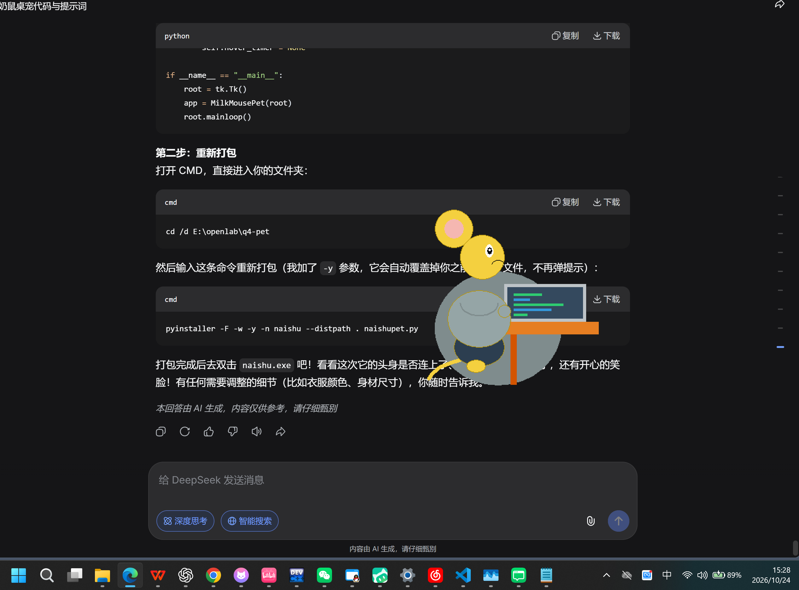

# 桌面宠物 DesktopPet

一个用 Python + tkinter 实现的常驻桌面小宠物。

## 功能
- 常驻桌面、窗口置顶、无边框、半透明
- 鼠标拖拽移动
- 自动随机走动（碰到屏幕边缘反弹）
- 点击弹出随机台词气泡
- 关闭后记住上次窗口位置（本地 JSON 保存）

## 环境要求
- Python 3.10 及以上
- tkinter（一般随 Python 自带；若缺失运行 `pip install tk`）

## 运行截图

## 运行方法
1. 确认已安装 Python 3.10 及以上（可在终端输入 `python --version` 查看）。
2. 在本项目文件夹中打开终端（PowerShell 或 Git Bash 均可）。
3. 运行：
      python naishupet.py

##更新版本
1.生成了一个 naishupet version2.py
2.运行方法同上，打开python编译运行

